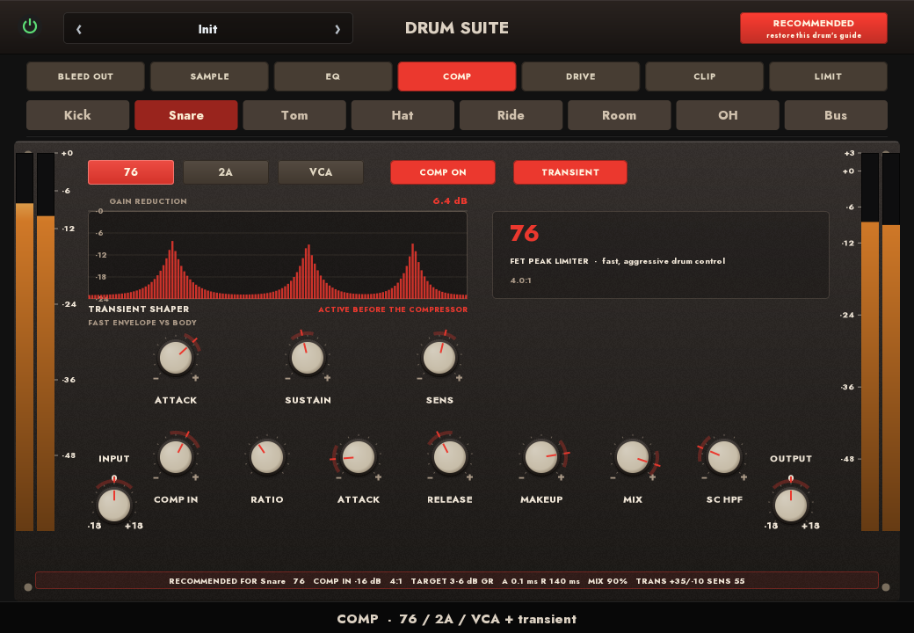
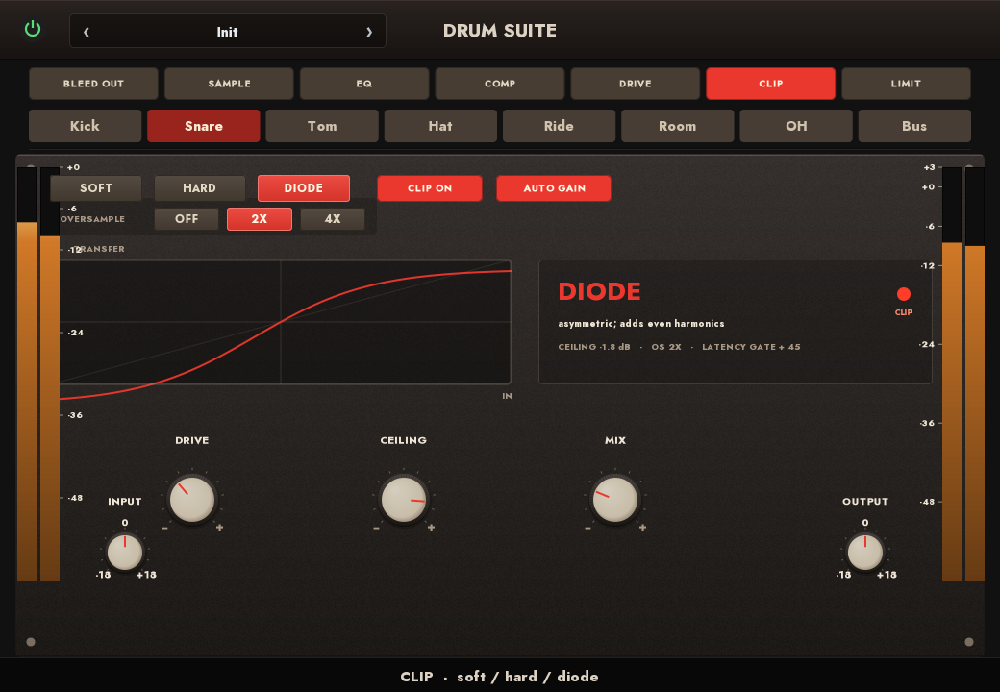

# Drum Suite

**Version 0.5.0 — Linux x86_64** · GPL-3.0-or-later

A drum channel strip in the Suite visual language. **Bleed Out**, **Sample**,
**EQ**, **Comp**, **Drive** and **Clip** are working; Limit follows in the next
milestone.


## Pages

The chain is fixed, left to right:

```text
Input → BLEED OUT → SAMPLE → EQ → COMP → DRIVE → CLIP → LIMIT → Output
```

| Page | Status |
|---|---|
| **BLEED OUT** | Working: Threshold, DeBleed, Ghost + scope |
| **SAMPLE** | Working: 4-voice loader, gate/transient trigger, pitch, start, reverse, choke, fade |
| **EQ** | Working: low shelf, two peaks, high shelf, HPF/LPF + curve |
| **COMP** | Working: 76 / 2A / VCA models, GR history |
| **DRIVE** | Working: Valve, Console, Bus, Tape, Transformer + auto gain |
| **CLIP** | Working: soft / hard / diode, 1x/2x/4x, ceiling and clip LED |
| **LIMIT** | Scaffolded; true-peak safety next |

The drum selector across the top chooses the profile: **Kick, Snare, Tom, Hat,
Ride, Room, OH, Bus**. It changes detector focus, gate defaults and sample
category, not the whole preset.

## Bleed Out

The full three-knob de-bleed gate from the standalone Bleed Out:

- **Threshold** — raise until the gate opens on every hit.
- **DeBleed** — high-band attenuation between hits, driven from the drum body.
- **Ghost** — ghost-note amount; the ghost icon toggles ghost mode.
- 2 ms fixed lookahead, profile-automated reduction/decay/attack/saturation.
- Scope with input and gate envelope.


## Sample

The Sample page layers a one-shot over the gated drum. Put mono or stereo WAV
files in:

```text
~/.local/share/drum-suite/samples
```

Click a file in the page to load it. The list refreshes while the editor is
open.

- **Sample On** enables the layer; loading a file turns it on.
- **Level** and **Direct** balance the sample against the gated direct signal.
- **Pitch** ±24 semitones, **Start** moves the playback start point.
- **Reverse**, **Choke** and **Fade** shape the one-shot.
- **Trigger** chooses **Gate** (Bleed Out opens), **Transient** (input
  transient) or **Always** (first transient regardless of the gate).
- Four voices; choke is on by default.

The waveform shows the loaded file. The sample is loaded from disk at runtime;
0.2.0 does not embed the audio in the plugin state yet, so a recalled session
shows the same folder and reloads the file from it.


## EQ

Four bands plus filters, all after the gate and sample layer:

- Low shelf at 80 Hz, low-mid peak at 250 Hz, high-mid peak at 1.2 kHz, high
  shelf at 6 kHz, ±12 dB each.
- HPF 20–500 Hz and LPF 500 Hz–20 kHz.
- The curve is drawn from the same biquad coefficients as the audio path.


## Compressor

Three drum-relevant models from Comp Suite, reusing the same DSP:

- **76** — blue-stripe FET peak limiter; fast and aggressive on kick, snare
  and toms.
- **2A** — optical leveler with program-dependent attack and release; the
  Ratio knob becomes the **Limit** switch above 4:1.
- **VCA** — clean, stereo-linked bus compressor for room, overheads and the
  drum bus.

Controls: Threshold, Ratio, Attack, Release (hidden on 2A), Makeup, Mix and
Sidechain HPF. A gain-reduction history runs above the controls, and the output
meters show the post-compressor level.

Each drum profile carries its own compressor model and defaults; selecting a
drum tab therefore changes the compressor as well as the gate.



## Drive

Five Patina saturation colours, one band, with a live transfer curve:

- **Valve** — even harmonics and a thick low mid.
- **Console** — op-amp edge for snare and tom cut.
- **Bus** — dense, controlled harmonic glue.
- **Tape** — soft top and a round low end.
- **Transformer** — iron weight and low-mid push.

Drive, Character, Tone and Mix shape the stage; **Auto Gain** tracks the input
and output level so parallel drive does not jump. The transfer display uses the
same shaper curve as the audio path.


## Clip

A controllable clipper after the drive stage:

- **Soft** — rounded knee that keeps the hit together.
- **Hard** — flat top for a dense, obvious clip.
- **Diode** — asymmetric clipping with even harmonics.
- Drive pushes into the ceiling; Ceiling sets the output limit (−12…0 dB).
- Mix blends the clipped and dry paths.
- Oversampling **1x / 2x / 4x**. The output is always padded to the same
  45-sample latency, so host delay compensation does not jump when the mode
  changes.
- **Auto Gain** only attenuates, so the ceiling still holds.
- The clip LED holds for 250 ms.



## Build

Requires CMake 3.16+, a C++20 compiler, Cairo, FreeType, X11 and LV2.

```sh
cmake -S . -B build -DCMAKE_BUILD_TYPE=Release
cmake --build build -j
ctest --test-dir build --output-on-failure
```

Install for the current user:

```sh
cmake -S . -B build \
  -DCLAP_DIR="$HOME/.clap" \
  -DLV2_DIR="$HOME/.lv2"
cmake --build build -j
cmake --install build
```

## Status

0.5.0 adds the clipper to the Sample/EQ/Comp/Drive build:

- 1040×720 panel with seven page tabs and the eight drum profiles.
- BLEED OUT page fully working (CLAP + LV2).
- SAMPLE page: folder browser, waveform, 4 voices, trigger from the gate,
  pitch/start/reverse/choke/fade and direct/sample balance.
- EQ page: four bands + HPF/LPF with a live curve.
- COMP page: 76, 2A and VCA models with GR history, makeup, mix and sidechain
  HPF; per-profile compressor defaults.
- DRIVE page: Valve, Console, Bus, Tape and Transformer models, transfer curve
  and auto gain; per-profile drive defaults.
- CLIP page: soft/hard/diode shapes, drive, ceiling, mix, 1x/2x/4x
  oversampling, auto gain and a clip LED.
- Fixed 45-sample clipper latency in every oversampling mode.
- Placeholder page for Limit.
- Tests: DSP, sample player, EQ response, compressor models, drive models,
  clipper shapes/ceiling/latency, panel loading, layout, geometry and TTL.

Next: Limit.

## Licence

GPL-3.0-or-later. See `THIRD_PARTY_NOTICES.md`.
