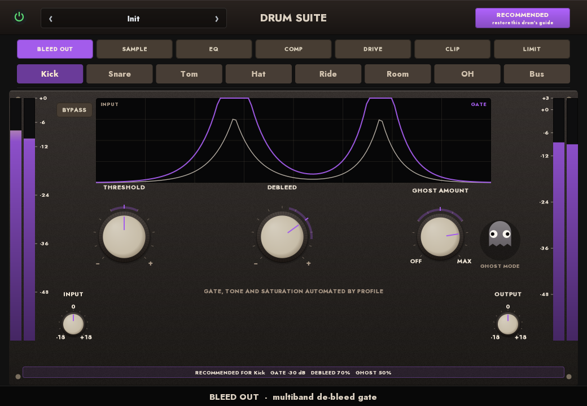
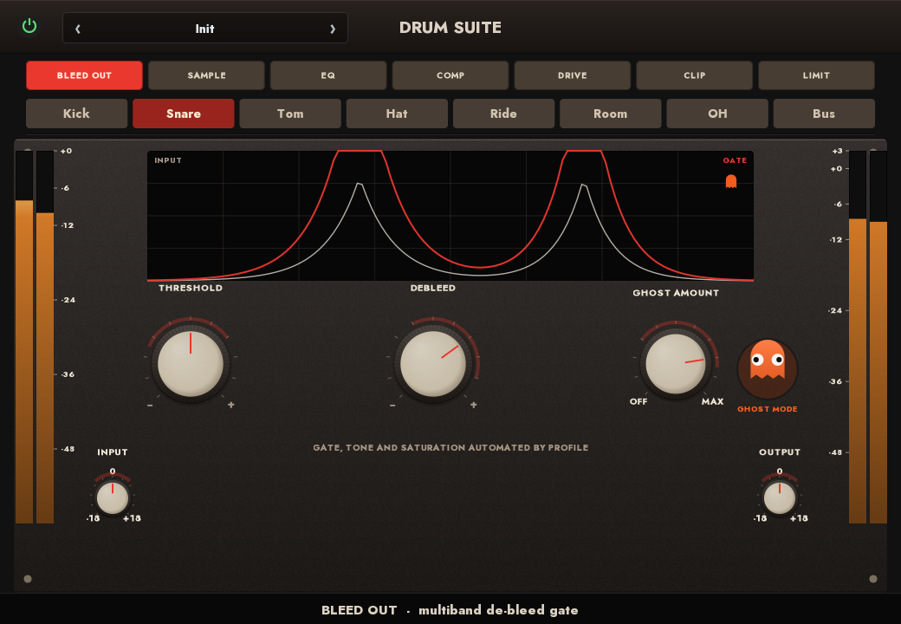
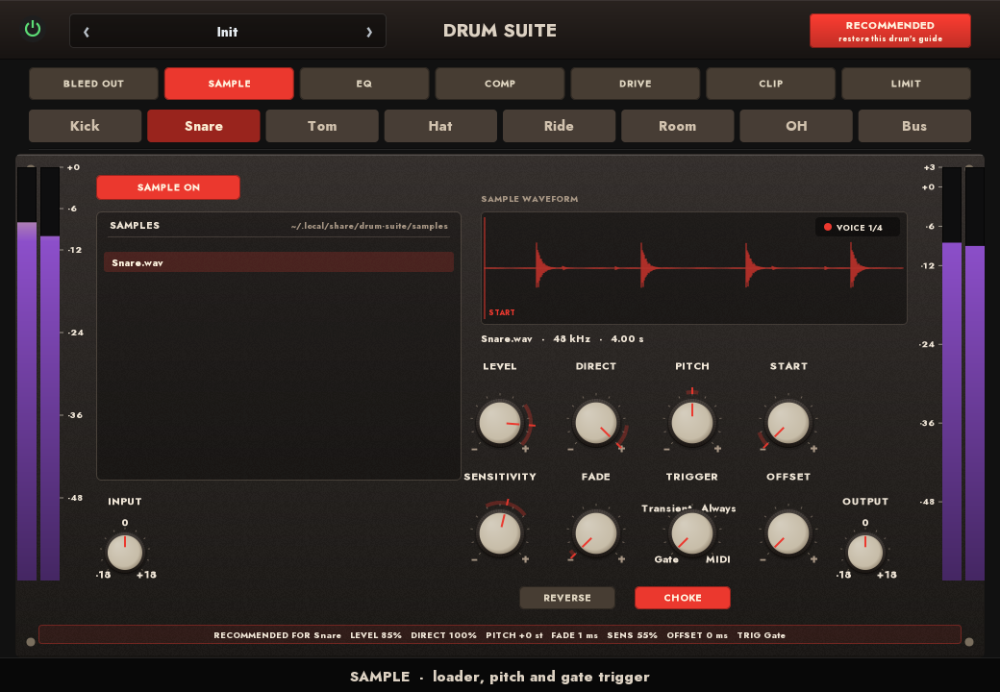
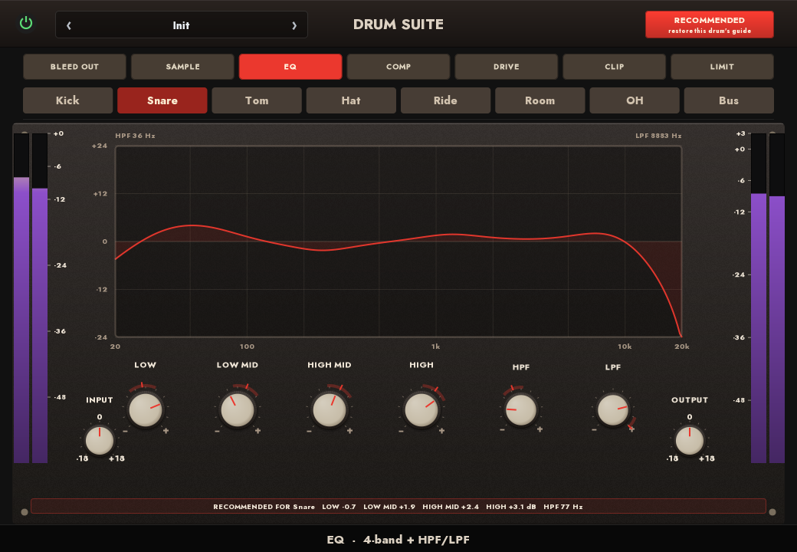
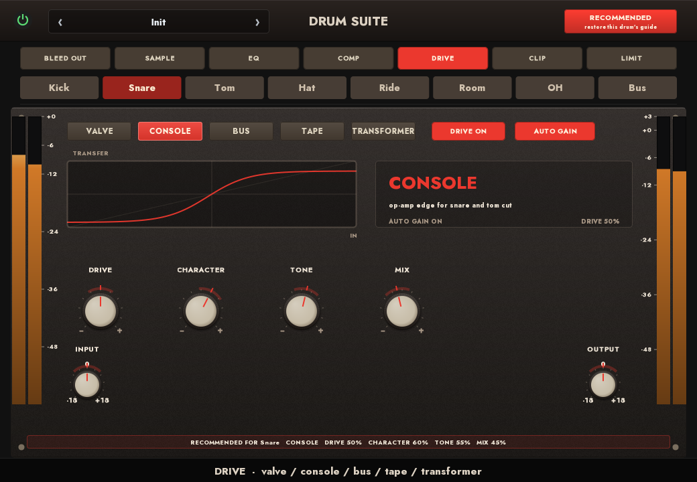
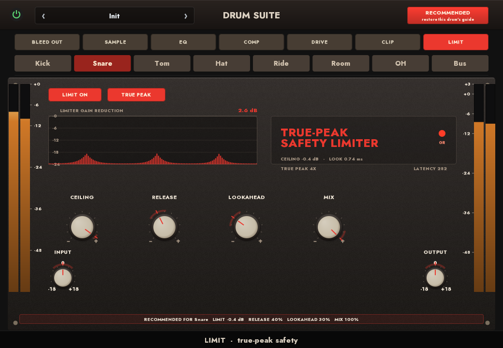

# Drum Suite

**Version 0.9.0 — Linux x86_64** · GPL-3.0-or-later

A drum channel strip in the Suite visual language. The whole chain is now
working: **Bleed Out → Sample → EQ → Comp → Drive → Clip → Limit**.



## Pages

The chain is fixed, left to right:

```text
Input → BLEED OUT → SAMPLE → EQ → COMP → DRIVE → CLIP → LIMIT → Output
```

| Page | Status |
|---|---|
| **BLEED OUT** | Working: Threshold, DeBleed, Ghost + scope |
| **SAMPLE** | Working: 4-voice loader, gate/transient trigger, pitch, start, reverse, choke, fade |
| **EQ** | Working: low shelf, two peaks, high shelf, HPF/LPF + curve |
| **COMP** | Working: transient shaper + 76 / 2A / VCA models, GR history |
| **DRIVE** | Working: Valve, Console, Bus, Tape, Transformer + auto gain |
| **CLIP** | Working: soft / hard / diode, 1x/2x/4x, ceiling and clip LED |
| **LIMIT** | Working: true-peak safety limiter with lookahead and GR history |

The drum selector across the top chooses the profile: **Kick, Snare, Tom, Hat,
Ride, Room, OH, Bus**. It changes detector focus, gate defaults and sample
category, not the whole preset.

## Bleed Out

The full three-knob de-bleed gate from the standalone Bleed Out:

- **Threshold** — raise until the gate opens on every hit.
- **DeBleed** — high-band attenuation between hits, driven from the drum body.
- **Ghost** — ghost-note amount; the ghost icon toggles ghost mode.
- 2 ms fixed lookahead, profile-automated reduction/decay/attack/saturation.
- Scope with input and gate envelope.



## Sample

The Sample page layers a one-shot over the gated drum. Put mono or stereo WAV
files in:

```text
~/.local/share/drum-suite/samples
```

Click a file in the page to load it. The list refreshes while the editor is
open.

- **Sample On** enables the layer; loading a file turns it on.
- **Level** and **Direct** balance the sample against the gated direct signal.
- **Pitch** ±24 semitones, **Start** moves the playback start point (shown as
  a marker on the waveform).
- **Reverse**, **Choke** and **Fade** shape the one-shot.
- **Trigger** chooses **Gate** (Bleed Out opens), **Transient** (independent
  input onset detector), **Always** (either audio source) or **MIDI**.
- **Sensitivity** sets the transient threshold.
- **Offset** delays the sample by 0–10 ms for alignment.
- Four voices; choke is on by default. The waveform badge shows the live voice
  count and trigger LED.
- The sample path is saved in CLAP/LV2 state and reloaded if the file is still
  in place.

The waveform shows the loaded file. The sample is loaded from disk at runtime;
0.2.0 does not embed the audio in the plugin state yet, so a recalled session
shows the same folder and reloads the file from it.



## EQ

Four bands plus filters, all after the gate and sample layer:

- Low shelf at 80 Hz, low-mid peak at 250 Hz, high-mid peak at 1.2 kHz, high
  shelf at 6 kHz, ±12 dB each.
- HPF 20–500 Hz and LPF 500 Hz–20 kHz.
- The curve is drawn from the same biquad coefficients as the audio path.



## Compressor and transient shaper

The COMP page starts with a stereo-linked transient shaper before the
compressor:

- **Attack** (−100…+100) boosts or softens the leading edge.
- **Sustain** (−100…+100) boosts or reduces the body after the hit.
- **Sens** adjusts the fast/slow envelope detector.
- The transient stage can be bypassed with the **TRANSIENT** switch.

It uses a fast envelope (0.2 ms attack, 40 ms release) and a slow body
envelope (15 ms attack, 180 ms release). Attack and Sustain are bipolar, so
the same knob tightens or thickens the drum.

Three drum-relevant compressor models follow, reusing Comp Suite's DSP:

- **76** — blue-stripe FET peak limiter; fast and aggressive on kick, snare
  and toms.
- **2A** — optical leveler with program-dependent attack and release; the
  Ratio knob becomes the **Limit** switch above 4:1.
- **VCA** — clean, stereo-linked bus compressor for room, overheads and the
  drum bus.

The drum guide sets sensible attack/sustain values per profile; the
RECOMMENDED button restores them.

Controls: Input / Peak Reduction / Threshold (model-dependent), Ratio,
Attack, Release (hidden on 2A), Makeup, Mix and Sidechain HPF. The models use
Comp Suite's output trim, so the default profiles sit within about 2 dB of the
input level. A gain-reduction history runs above the controls, and the output
meters show the post-compressor level.

Each drum profile carries its own compressor model and defaults; selecting a
drum tab therefore changes the compressor as well as the gate.


## Drive

Five Patina saturation colours, one band, with a live transfer curve:

- **Valve** — even harmonics and a thick low mid.
- **Console** — op-amp edge for snare and tom cut.
- **Bus** — dense, controlled harmonic glue.
- **Tape** — soft top and a round low end.
- **Transformer** — iron weight and low-mid push.

Drive, Character, Tone and Mix shape the stage; **Auto Gain** tracks the input
and output level so parallel drive does not jump. The transfer display uses the
same shaper curve as the audio path.



## Clip

A controllable clipper after the drive stage:

- **Soft** — rounded knee that keeps the hit together.
- **Hard** — flat top for a dense, obvious clip.
- **Diode** — asymmetric clipping with even harmonics.
- Drive pushes into the ceiling; Ceiling sets the output limit (−12…0 dB).
- Mix blends the clipped and dry paths.
- Oversampling **1x / 2x / 4x**. The output is always padded to the same
  45-sample latency, so host delay compensation does not jump when the mode
  changes.
- **Auto Gain** only attenuates, so the ceiling still holds.
- The clip LED holds for 250 ms.


## Limit

The final safety stage is a lookahead limiter:

- Ceiling −12…0 dB, Release 20…1000 ms, Lookahead 0.2…2 ms.
- **True Peak** runs 4× oversampled detection; off falls back to sample peaks.
- Mix blends the limited and dry paths.
- The detector lookahead changes without moving host delay compensation: the
  stage always reports 141 samples (2 ms + the half-band filter).
- Gain-reduction history and a red GR indicator.
- The whole chain reports 282 samples at 48 kHz (gate + clipper + limiter).



## Per-drum recommended settings

Each drum tab carries a complete guide for the whole strip, not just the gate:
threshold and DeBleed, EQ moves and filters, compressor model and time
constants, drive colour, clip shape, limiter ceiling and sample defaults. The
guide is applied when you pick a drum, so a new mixer starts from a sensible
Kick, Snare, Tom, Hat, Ride, Room, OH or Bus setup instead of a blank channel.

The strip at the bottom of every page names the current target values. Active
continuous knobs also show a translucent recommended arc plus a small gold
target tick. If you change a module and want the starting point back, click
**RECOMMENDED** in the header (or double-click a knob to return that parameter
to the current drum's guide).

## Known limitations

- The sample path is saved, not the audio. If the WAV moves or is deleted,
  the slot recalls empty.
- MIDI sample triggering responds to any note-on because 0.8 has one sample
  slot.
- Trigger offset is positive (0–10 ms); negative pre-trigger is not implemented.
- After an LV2 state recall, the audio sample reloads, but the LV2 editor may
  keep showing the previous sample name until it is reopened.

## Build

Requires CMake 3.16+, a C++20 compiler, Cairo, FreeType, X11 and LV2.

```sh
cmake -S . -B build -DCMAKE_BUILD_TYPE=Release
cmake --build build -j
ctest --test-dir build --output-on-failure
```

Install for the current user:

```sh
cmake -S . -B build \
  -DCLAP_DIR="$HOME/.clap" \
  -DLV2_DIR="$HOME/.lv2"
cmake --build build -j
cmake --install build
```

## Status

0.9.0 adds the transient shaper and completes a regression pass over the
Suite plugins:

- 1040×720 panel with seven page tabs and the eight drum profiles.
- BLEED OUT page fully working (CLAP + LV2).
- SAMPLE page: folder browser, waveform, 4 voices, trigger from the gate,
  pitch/start/reverse/choke/fade and direct/sample balance.
- EQ page: four bands + HPF/LPF with a live curve.
- COMP page: 76, 2A and VCA models with GR history, makeup, mix and sidechain
  HPF; per-profile compressor defaults.
- DRIVE page: Valve, Console, Bus, Tape and Transformer models, transfer curve
  and auto gain; per-profile drive defaults.
- CLIP page: soft/hard/diode shapes, drive, ceiling, mix, 1x/2x/4x
  oversampling, auto gain and a clip LED.
- Fixed 45-sample clipper latency in every oversampling mode.
- LIMIT page: true-peak lookahead limiter, ceiling, release, lookahead, mix,
  GR history and a fixed 141-sample stage latency.
- Every page is inset inside the input/output meter rails.
- Suggested-range arcs on continuous knobs, matching Vocal Suite.
- Sample trigger modes now behave differently: Gate, Transient and Always.
- Sample trigger sensitivity, voice-count badge and start marker.
- Compressor gain staging corrected with the model output trims; default
  profiles now land within about 2 dB of the input level.
- Power now bypasses the whole chain; True Peak actually switches between
  4× detection and sample peaks.
- Recommended button and per-page value bar, using the drum cheat-sheet
  starting points.
- COMP page transient shaper with bipolar Attack/Sustain and per-drum guide
  values.
- Sample path saved in CLAP state and the LV2 state interface; reloaded on
  recall.
- MIDI sample trigger mode, any note-on.
- 0–10 ms trigger offset and sample sensitivity.
- Five full-chain factory presets.
- Every page stays inside the meter rails; the Sample browser is shortened so
  it no longer covers the global Input knob.
- Transient shaper in the COMP page, before the compressor.
- Per-drum transient defaults in the recommended guide.
- All Suite plugin test suites were run as a regression pass.
- Tests: DSP, transient shaper, sample player/trigger modes/MIDI/offset, EQ,
  compressor, drive, clipper, limiter, suggested ranges, state helpers,
  full-chain rates, power bypass, recommended guide, panel loading, layout,
  geometry and TTL.

Next: release QA.

## Licence

GPL-3.0-or-later. See `THIRD_PARTY_NOTICES.md`.
